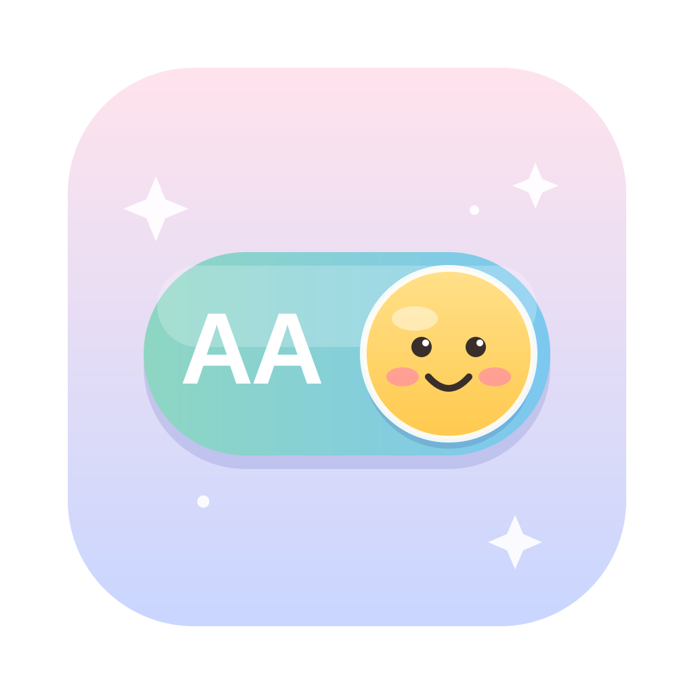
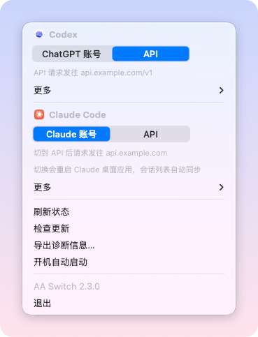
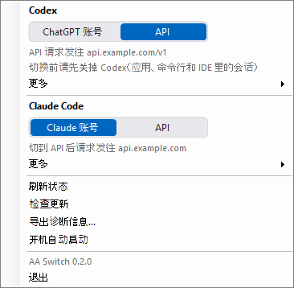
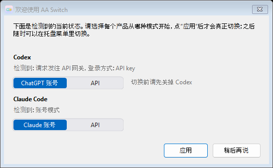
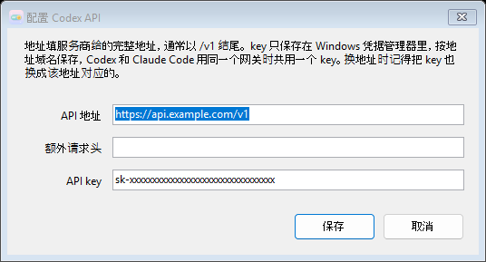

  

<h1 align="center">AA Switch</h1>

  让 Codex 和 Claude Code 在账号和你自己的 API 之间一键切换。 
  会话不丢，登录不掉。

  <a href="https://aaswitch.omniapexroute.com">官网</a>
  &nbsp;·&nbsp;
  <a href="README.md">English</a>

---

## 为什么叫 "AA"？

**AA** 是 **API – Account** 的缩写。AA Switch 只做一件事：让 Codex 和 Claude Code 在你自己的 **API** key 和官方 **账号（Account）** 之间来回切换。

## 它能做什么

AA Switch 住在 Mac 的菜单栏（或 Windows 的托盘）里，点开就能看到 Codex 和 Claude Code 现在各走的是哪边。再点一下就切。

<table align="center">
  <tr>
    <td align="center" valign="top"> macOS</td>
    <td align="center" valign="top"> Windows</td>
  </tr>
</table>

- **两种模式，一键切换。** 用订阅账号，或者走你自己的 API key，想换随时换。Codex 和 Claude Code 各自独立切换。
- **历史会话跟着走。** 切换前后，所有对话都还在，都能继续聊。
- **不用重新登录。** AA Switch 记得你的 ChatGPT 登录态，切回账号时不用再登一次；Claude 账号的登录态则根本不会被动。
- **默认就安全。** 每次切换前先备份设置，出了问题自动恢复。
- **一个 key 两边用。** 同一个网关的 key 只需要填一次，Codex 和 Claude Code 共用。

## 安装

### macOS

1. 到官网 [aaswitch.omniapexroute.com](https://aaswitch.omniapexroute.com) 下载 **AA Switch.dmg**（国内直连；也可从 [Releases](https://github.com/yhq1998/AA-switch/releases) 下载）。
2. 打开 dmg，把 **AA Switch** 拖进“应用程序”文件夹，再从“应用程序”打开它。直接在 dmg 里双击也行，它会提示把自己装进“应用程序”并推出安装盘。
3. 屏幕右上角会出现一个小开关。

需要 macOS 13 或更新版本，Intel 和 Apple 芯片都支持（通用二进制）。Codex 桌面应用、Claude Code（终端或 IDE 插件）至少装一个。

### Windows

1. 到官网 [aaswitch.omniapexroute.com](https://aaswitch.omniapexroute.com) 下载 **AA Switch.exe**（也可从 [Releases](https://github.com/yhq1998/AA-switch/releases) 下载）。
2. 双击运行，选 **是** 装到这台电脑上（装在当前用户的目录里，不需要管理员权限，也不用装任何运行时）。装好后会从开始菜单里的位置重新打开，“下载”里的那个文件会自动删掉。以后在开始菜单里搜 AA Switch 就能打开，卸载在 **设置 → 应用** 里。
3. 屏幕右下角的托盘里会出现一个笑脸图标（可能收在 **^** 里，可以把它拖到任务栏上常驻）。找不到图标时，从开始菜单再打开一次 AA Switch，会弹出一个窗口，功能和托盘菜单一样。

需要 Windows 10 或 11（64 位）。Windows 版目前没有代码签名，第一次运行可能被 SmartScreen 拦下：点 **更多信息 → 仍要运行**。
Codex（命令行或 IDE 插件）、Claude Code（终端或 IDE 插件）至少装一个。

  

## 使用

点一下菜单栏（Windows 是托盘）里的图标。

- 菜单分 **Codex** 和 **Claude Code** 两组，每组一行 **账号 | API** 开关，亮着的那格就是当前模式，下面的小字写着请求发往哪里。
- 点另一格就切换。macOS 上 Codex 会自动退出并重新打开，几秒钟就好；Claude Code 不用重启，终端和 IDE 插件里新开的会话立即生效。
- 第一次切到 API 时，AA Switch 会请你填写 API 地址和 key，保存前会用 key 试一下这个地址通不通。key 只存在 macOS 钥匙串（Windows 是凭据管理器）里，不会写进任何文件。
- 第一次切换 Codex 时，macOS 会问是否允许 AA Switch 控制 Codex。选 **允许**，它需要这个权限来重启 Codex。

  

在菜单里打开 **开机自动启动**，AA Switch 就一直都在。有新版本时菜单底部会提示，点一下就自动更新。

### Windows 版暂时的不同

- 切换 Codex 前要自己先关掉 Codex（应用、命令行和 IDE 里的会话），AA Switch 不会替你退出和重开；没关的话它会提醒你，什么都不会改。
- Claude 桌面应用的 Code 标签还不能切到 API（见下面“小提示”的最后一条），终端和 IDE 插件里的 Claude Code 不受影响。
- 开机自动启动记的是 exe 当时所在的位置，打开它之后就别再移动 exe 了。

### Claude 账号环境检测（macOS）

Claude Code 处于账号模式、Claude 桌面应用也未处于网关模式时，菜单中会显示 **账号环境检测…**。首次使用先确认代理客户端、目标国家、时区、地区和 Clash Verge 代理组，再开始检测。初始预填的是原项目的美国 / 纽约基准，请按自己的环境修改。

检测直接复用 [Claude Switcher](https://github.com/YOURSJEYO/claude-switcher) 的 14 项原版判断：代理内核、TUN、出口 IP、IP 一致性、时区、地区、IPv6、DNS、WebRTC/STUN、保镖、规则置顶、客户端语言、ASN 属性和生态可达性。需要已安装 Python 3 运行原版 STUN 探针；AA Switch 不会自动安装依赖。可重新检测、修改检测设置或手动导出结果。

此入口只做检测，不修改系统或代理设置、不切换登录数据、不安装守护进程，也不阻止账号切换。原版“保镖”未安装时会显示未通过；fake-IP/TUN、关闭 IPv6 等结果沿用原项目标准，不能据此保证账号可用或防止 IP 泄漏。此功能不检测 Codex 或 API 网关。

检测会联系 Cloudflare、ipinfo.io、Claude / Anthropic 和原版 STUN 服务。出口 IP 历史及检测结果保存在 `~/Library/Application Support/AA Switch/claude-account-environment/`，不会读取账号凭据；导出文件包含 IP 信息，分享前请自行确认。源码来源、固定提交及 MIT 许可见 [第三方代码说明](menubar/vendor/claude-switcher/README.md)。

## 小提示

- macOS 上切换 Codex 会自动退出 ChatGPT / Codex 桌面应用，并关闭当前用户的 Codex 终端和 IDE 会话；正在执行的任务会中断。后台进程先正常终止，仍不退出时再强制结束，确认关闭后才修改配置。桌面应用切换后会重新打开，终端 / IDE 会话需要自己重新开启。Windows 上仍需手动关闭。
- 切回账号后如果 Codex 让你登录，只是登录态过期了，登一次就好。
- 每次切换前的备份在 `~/.codex/codex-mode-backups` 和 `~/.claude/claude-mode-backups`（Windows 上 `~` 是 `C:\Users\你的用户名`；只留最近 20 次），各自"更多"里的 **打开备份文件夹** 可以直达。
- Claude Code 走 API 时，依赖 Claude 账号的功能（发布 Artifact、云端会话、/schedule、connectors）暂时不可用，切回账号就恢复。
- Claude 桌面应用切到 API 时，默认允许 Cowork / Code 工具访问所有外网域名；已有的域名白名单也会被替换。网页抓取仍受 Claude 内置的 localhost / 内网访问限制。
- macOS 上，Claude Code 的开关同时管终端 / IDE 插件和 Claude 桌面应用的 Code 标签。桌面应用启动 Code 会话时会强制使用自己的登录凭据，所以切到 API 时 AA Switch 会把整个桌面应用切到第三方推理模式并重启它，会话列表自动同步；API 模式下桌面应用的普通聊天不可用，切回账号即恢复。

---

开发者与维护者请看 [DEVELOPMENT.md](DEVELOPMENT.md)。
